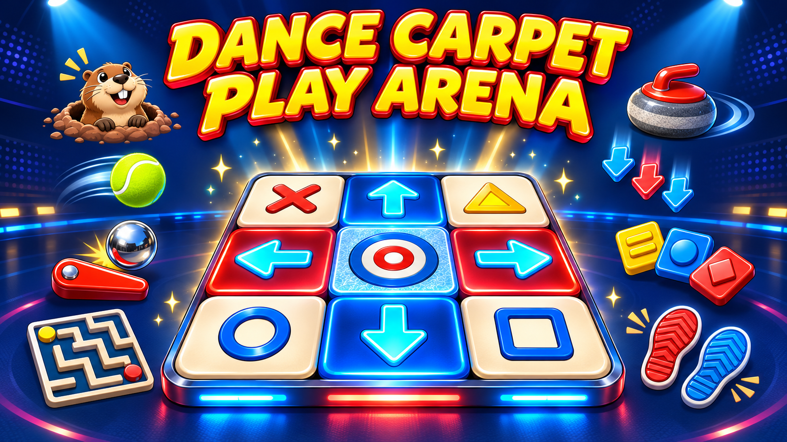

# Dance Carpet Play Arena



Colección de **minijuegos para alfombra de baile USB** (las alfombras genéricas de PC de 3×3 casillas con flechas,
✕ ○ △ □, Select y Start). Se juega con los pies… y se suda. También funciona con el teclado.

Hecho con **Godot 4.7 (C#)**. Interfaz en español.

## Juegos

| Juego | De qué va |
|---|---|
| **Topos** | Pisa los topillos antes de que se escondan; el dorado vale ×5 y las bombas te aturden. |
| **Simón dice** | Repite la secuencia de casillas y notas, cada vez más larga. |
| **Flechas que caen** | Juego de ritmo con 7 canciones: pisa cada figura cuando llega a su diana. |
| **Laberinto** | Inclina el tablero pisando hacia un lado y lleva la bola a la meta (hielo, imanes y puertas). |
| **Ejercicio** | 20 series de pasos al ritmo de la música, con flechas que indican qué pie mover. |
| **Circuito** | Seis juegos seguidos de 1–3 minutos con descansos, como una clase de gimnasio. |
| **Tenis** | Partido y torneo: golpea la bola y apunta a la zona débil del rival. |
| **Pinball** | Palancas con tres fuerzas, setas, dianas, multibola y «Stay Cool!». |
| **Curling** | Lanza, barre con dos barrenderos y deja la piedra en la casa. Solo, contra la máquina o contra otra persona. |
| **Deletrear** | Pisa las letras en orden para formar palabras. |
| **Adivinanza** | Lee la pista y pisa la respuesta. |

Además: 11 temas de color, récords, contador de pasos y tiempo, música y efectos con volumen propio.

## Descargar y jugar (Windows)

1. Descarga el `.zip` de la última versión en [Releases](../../releases) y descomprímelo.
2. Enchufa la alfombra por USB (opcional) y abre `DanceCarpetPlayArena.exe`.
3. La primera vez con alfombra, el juego pide **calibrarla**: pisa cada casilla cuando te lo indique.

**Sin alfombra**, con el teclado (misma forma que la alfombra):

```
  Esc = Select          Intro = Start

    Q   W   E           ✕   ↑   ○
    A   S   D     =     ←   ·   →
    Z   X   C           △   ↓   □
```

Las flechas del teclado también valen para ↑ ↓ ← →. **Espacio** cierra el juego.

## Compilar desde el código

- [Godot 4.7.2 .NET (mono)](https://godotengine.org/download) y .NET SDK 8.
- Abre `project.godot` con Godot y pulsa ▶. Para exportar, usa el preajuste «Windows Desktop».
- Pruebas (física del pinball y del curling, marcador del tenis y archivos de datos), sin abrir Godot:

  ```
  dotnet test tests/AlfombraBaile.Tests
  ```

Los contenidos se pueden editar sin tocar código: palabras y adivinanzas en `assets/palabras/`, laberintos en
`assets/laberintos/` y ejercicios en `assets/ejercicios/` (las pruebas comprueban que siguen siendo válidos).

## Créditos

- **Programación, diseño y test:** Claude — [claude.ai](https://claude.ai)
- **FDE, arnés y dirección:** Vicente Simón — [linkedin.com/in/vicentesimon](https://www.linkedin.com/in/vicentesimon)
- **Planteamiento de juegos:** Claude y Vicente Simón
- **Ayudante de diseño visual:** GPT — [chatgpt.com](https://chatgpt.com)
- **Música:** Suno — [suno.com](https://suno.com/)
- **Efectos de sonido:** Kenney (CC0) — [kenney.nl](https://kenney.nl); algunos, generados por código
- **Tipografías:** Bungee y Outfit (SIL OFL)

## Licencia

[Apache 2.0](LICENSE). Se puede copiar, modificar y redistribuir libremente, pero toda copia o versión derivada debe
**conservar el fichero [NOTICE](NOTICE)** —con la referencia a este proyecto como original y sus créditos— e
**indicar qué se ha modificado**. El material de terceros (sonidos, tipografías) tiene sus propias licencias, detalladas en NOTICE.

**La música no está incluida en la licencia Apache 2.0:** se generó con el plan gratuito de Suno, así que es
propiedad de Suno y solo puede usarse **sin fines comerciales** y citando a Suno (ver NOTICE).
